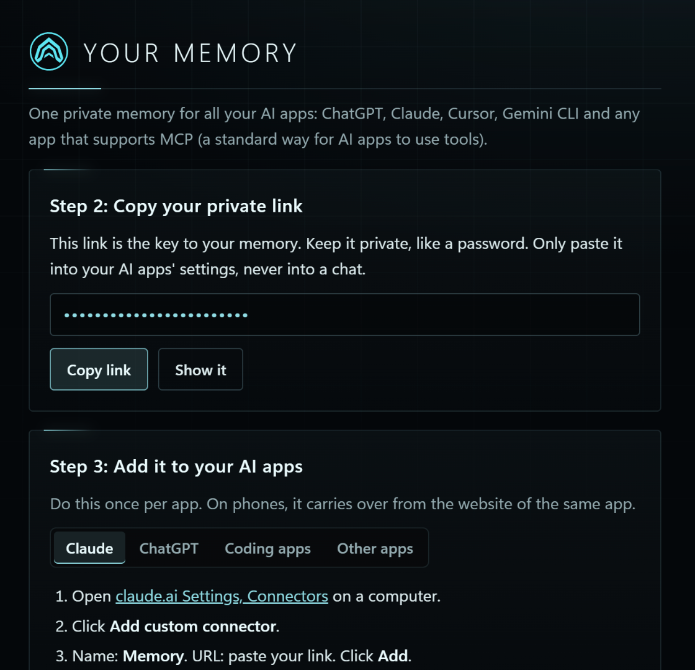

<p align="center">
  
</p>

<p align="center">
  <a href="LICENSE"></a>
  
  
  
</p>

**One private memory for all your AI apps.**

Tell ChatGPT something on your phone. Claude, Gemini or Cursor knows it on your laptop an hour later. You never repeat yourself again.

Works with **ChatGPT, Claude, Gemini CLI, Cursor, VS Code, Windsurf, Codex, Claude Code** and any other app that supports MCP.

<p align="center">
  
</p>

> **What is MCP?** It's the standard plug that lets AI apps use outside tools. If an app's settings mention **Connectors**, **Integrations**, **Tools** or **MCP servers**, your memory works there.

- **Private.** Your memory lives in your own account or on your own computer. There is no company in the middle, not even us.
- **Free.** No subscription. Runs on Cloudflare's free plan, or on your computer.
- **Yours.** Your memory is a set of plain notes you can read, download and keep.
- **Careful.** It refuses to save passwords or keys, and it never deletes: when something changes, the old version is kept.

---

## Set it up (about 5 minutes, no coding)

Pick the one that fits you:

| I want my memory... | Use |
|---|---|
| **On my phone and my computer, in any AI app** | [Option 1: Everywhere](#option-1-everywhere-phone-and-computer) |
| **Only on this computer, in Claude Desktop** (most private) | [Option 2: Claude Desktop](#option-2-claude-desktop-only) |
| **In my coding tools** (Claude Code, Codex, Cursor, Gemini CLI, VS Code) | [Option 3: Coding agents](#option-3-coding-agents) |

### Option 1: Everywhere (phone and computer)

This gives your memory its own small, private home in a free Cloudflare account. Cloudflare is a large internet company; this uses their free plan and needs no credit card.

1. Click this button:

   [](https://deploy.workers.cloudflare.com/?url=https://github.com/jacobbarglof/thron-memory)

2. Sign in to Cloudflare, or create a free account. If it asks you to connect GitHub, create a free GitHub account too (it keeps your copy of the code).
3. When you see **MEMORY_PASSWORD**, make up a password and **write it down**.
4. Click **Create and deploy**. Wait about a minute.
5. Click the web address it shows you (it ends in `workers.dev`). That page is **your memory's home**. Bookmark it.
6. Type your password. Click **Copy link**.
7. The page shows you exactly where to paste the link for Claude, ChatGPT and other apps. Do it once per app.

<p align="center">
  
</p>

Done. Try it: tell one app *"Remember that my favorite color is green,"* then ask a different app or your phone *"What's my favorite color?"*

Come back to your memory's home anytime to connect another app or download a copy of everything it remembers.

### Option 2: Claude Desktop only

Nothing to sign up for. Your memory stays on this computer.

1. Download **[thron-memory.mcpb](https://github.com/jacobbarglof/thron-memory/releases/latest/download/thron-memory.mcpb)**.
2. Double-click it. Claude Desktop opens. Click **Install**.

Done. Your memory is saved as notes in a folder called `thron-memory` in your home folder.

### Option 3: Coding agents

Paste this into Claude Code, Codex, Gemini CLI, Cursor or any agent that can run commands:

```text
Install thron-memory for me: run `npx -y thron-memory setup` and tell me what it printed.
```

It connects every coding app it finds: Claude Code, Codex, Gemini CLI, Cursor, VS Code, Windsurf and Claude Desktop. It needs [Node.js](https://nodejs.org) 18 or newer.

Want the same memory on your phone too? Paste this next. It moves your memory into your own free Cloudflare account and keeps everything you already saved:

```text
Set up thron-memory for my phone: run `npx -y thron-memory cloud`. If a Cloudflare sign-in page opens, I'll sign in.
```

A small window then shows your private link and where to paste it.

---

## Make it even smoother (optional)

The **skill** is a short set of instructions that helps Claude and ChatGPT decide when to check and update your memory.

- **Claude:** download [thron-memory-skill.zip](https://github.com/jacobbarglof/thron-memory/releases/latest/download/thron-memory-skill.zip), then go to **Customize > Skills > Upload**.
- **ChatGPT** (plans with Skills): **Skills > Create > Upload from your computer**, same file.

Apps without skills still work. Your memory tells every app how to use it as soon as it connects.

## What your memory looks like

Your memory is a set of short pages, one per person, project or topic:

```markdown
---
title: Alex Kim
updated: 2026-11-13
status: current
---
My manager at Acme.

## Current
- Prefers afternoon meetings (2026-11-13, chat)

## History
- [2026-11-13] was: Prefers morning meetings (2026-10-02, email)
```

Two pages are special:

- **core**: your rules for every AI app. Ask any app to change it, for example *"Add a rule to my memory: never save anything about my health."*
- **inbox**: notes the app wasn't sure where to put. Apps tidy it up later.

## Privacy

| | Option 1: Everywhere | Option 2: Claude Desktop | Option 3: Coding agents |
|---|---|---|---|
| Where it lives | Your own Cloudflare account | Your computer | Your computer (or your Cloudflare account after `cloud`) |
| Stored encrypted | Yes, including page names | No (plain notes you can open) | Same as the place it lives |
| Who can read it | Anyone with your private link | Apps on this computer | Apps on this computer |
| Request logs | Turned off | None | None |

Good to know:

- **Your private link is the key.** Treat it like a password. Paste it only into app settings, never into a chat.
- **AI apps see what they read.** When ChatGPT or Claude reads a page, that text goes to them like anything else you type. Keep truly secret things out of memory.
- **Extra privacy for Option 1:** after setup, delete the `MEMORY_PASSWORD` secret in Cloudflare (your memory's home page shows where). Your password still opens your memory's home, and Cloudflare no longer holds anything that can unlock your memory.
- **Option 3 with `cloud`** is the strictest cloud setup: your private link is made on your computer and Cloudflare only ever sees a fingerprint of it.
- Your memory's pages are decrypted only briefly, inside your own Cloudflare account, while an app is using them.
- No tracking, no analytics, nothing sent to us. The code is small so anyone can check it ([`src/`](src)).

## Questions

**Does it cost anything?** No. Cloudflare's free plan covers it easily, and it sleeps when nobody is using it.

**Which apps work?** Any app that can add an MCP server or "custom connector": ChatGPT (developer mode, on plans that have it), Claude (web, desktop and phone), Gemini CLI, Cursor, VS Code, Windsurf, Codex, Claude Code, and more every month.

**I forgot my password.** Open your memory's home and click **I forgot my password**. You can start over with a new one, but that erases the memory, because it was locked with the old password. Download a copy now and then.

**Can I see or edit my memory myself?** Yes. Option 1: click **Download a copy of my memory** on your memory's home. Options 2 and 3: open the `thron-memory` folder in your home folder with any text editor or [Obsidian](https://obsidian.md).

**How do I remove it?** Remove the connector from each app. Option 1: delete the `thron-memory` Worker in your Cloudflare dashboard. Option 2: uninstall the extension in Claude Desktop's settings. Option 3: run `claude mcp remove thron-memory -s user` (and the same for other apps), then delete the `.thron-memory` folder.

---

## For developers

**Commands** (Option 3):

```bash
npx -y thron-memory setup    # memory folder + connect coding apps on this computer
npx -y thron-memory cloud    # move memory to your Cloudflare account, for phone and web apps
npx -y thron-memory url      # show your private link (to you, never to an agent)
npx -y thron-memory backup   # copy cloud memory into ~/thron-memory
npx -y thron-memory status   # where memory lives
```

**Tools** the server gives every app:

| Tool | What it does |
|---|---|
| `overview` | Start of every task: your rules, a list of pages, the inbox, anything in conflict |
| `search` | Finds facts; returns short snippets, not whole pages |
| `read` | Reads a page or one section of it |
| `remember` | Saves a fact to the right page, or to the inbox if unsure |
| `update_fact` | Changes a fact; the old one moves to History with the date |
| `write_page` | Rewrites a page (filing the inbox, merging); the old version is kept |

**Connect any MCP client by hand.** Remote (Streamable HTTP): use your private link, or `https://<your-worker>.workers.dev/mcp` with the header `Authorization: Bearer <token>`. Local (stdio), after running `setup` once:

```json
{ "mcpServers": { "thron-memory": { "command": "node", "args": ["/Users/you/.thron-memory/app/bin/cli.js"] } } }
```

**How it's built.** Under 1,500 lines of plain JavaScript, zero dependencies.

- `src/memory.js`: the memory and its six tools.
- `src/mcp.js`: the MCP protocol.
- `src/local.js`: the file store.
- `src/worker.js`: the encrypted Cloudflare store. It uses AES-256-GCM with HKDF-derived keys, and page names are hidden with HMAC.
- `src/page.js`: your memory's home page.
- `bin/cli.js`: the commands.
- `desktop/manifest.json`: the Claude Desktop extension.

Run `npm test`. Run `node scripts/build.mjs` to build the release downloads. Run `python assets/make_visuals.py` to rebuild the images; they use the ThronOS mark and its Saira and Fira Mono fonts, which are under the SIL Open Font License ([`assets/fonts`](assets/fonts)).

## Part of ThronOS


thron-memory is one small part of **ThronOS**, the larger internal system I built to run my own agents across my computers and phone. ThronOS also handles to-dos, scheduling, jobs that run across machines, devices and voice; it stays private. This repo opens up just its memory, so anyone can give their AI apps one memory they own.

The ideas carry over directly:
- Every fact lives on one page.
- Changes keep their history.
- Conflicts are flagged for you instead of guessed.
- Agents write as they work, without being asked.

<br clear="left">

## License

[MIT](LICENSE). Use it, change it, share it.
